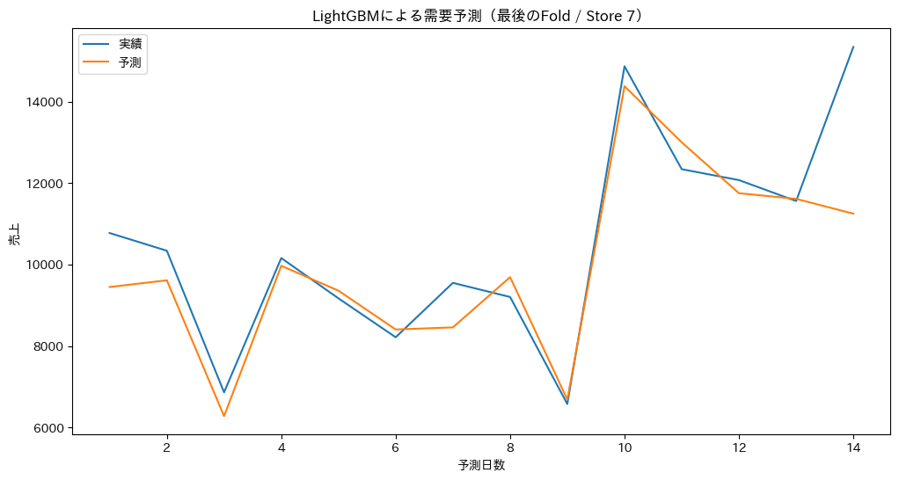

# rossmann-sales-forecasting-lightgbm
LightGBMによる時系列売上予測（Rossmann Store Salesデータ・単店舗分析）

Kaggleの「Rossmann Store Sales」データセットを用いた、LightGBMによる需要予測モデルの実装サンプルです。 実務を想定し、時系列データの特性を考慮した検証プロセス（Expanding Window CV）を採用しています。

## プロジェクト概要  
本プロジェクトの目的は、過去の売上データ、プロモーション情報、カレンダー情報を活用し、特定店舗の将来14日間の売上を精度高く予測することです。  
分析結果サマリー (Store No.7)  
本モデルの検証において、単純なラグ予測（前々週の同時期の売上を予測値とする手法）と比較し、売上予測精度を 59.1% 改善することができました。  
•	CV平均 RMSE(%): 14.25%（平均売上に対する誤差の割合）  
•	CV平均 ベースライン比MAE: 0.409（lag_14予測のMAEを1.0とした比。1.0を下回るほどベースラインより良い）  
•	ベースライン改善率: 59.1% 向上

## 実装のこだわり（技術的ポイント） 
•	リーク（データ漏洩）の厳密な排除:  
14日先までの予測を行う実務運用を想定し、すべてのラグ特徴量（lag）や移動平均（rolling_mean）において、予測起点から14日以上前の実績のみを使用するように設計しています。  
•	時系列交差検証（Expanding Window CV）:  
ランダムな分割ではなく、時間の流れに沿って学習期間を拡張しながら検証を行うことで、実運用に近い精度の評価を行っています。  
  Expanding Window CV  
    Fold1 train[------] test[--]  
    Fold2 train[----------] test[--]  
    Fold3 train[--------------] test[--]  
      
•	堅牢な欠損値処理: 店舗によって「継続プロモーション（Promo2）」を実施していないケース（NaNが発生）を考慮し、安易な全削除（dropna）ではなく、特徴量として必須な項目に絞ったクレンジングを行っています。  

##  使用技術 
•	Language: Python 3.x  
•	Model: LightGBM (LGBMRegressor)  
•	Evaluation: RMSE, MAE, ベースライン比MAE(lag_14予測に対する比)  
•	Visualization: Matplotlib, Seaborn, Japanize-matplotlib  

##  予測精度の結果
| Fold | RMSE(%) |  MAE | vs Baseline |
|------|---------|------|-------------|
| 1    | 13.65%  | 1046 | 57.1% better|
| 2    | 17.24%  | 1556 | 48.1% better|
| 3    | 11.86%  |  751 | 72.1% better|
| Mean | 14.25%  | 1118 | 59.1% better|

※ early stoppingは、学習データの直近14日を検証用に取り分けて実施しています(テスト期間は評価にのみ使用)。

##  分析結果の解釈 
特徴量重要度（Gain）の分析により、以下の知見が得られました。  
•	プロモーション（Promo）: 売上に最も寄与している因子であり、施策の有無が予測の鍵となっています。  
•	季節性（Calendar info）: 曜日や月といった周期性が安定して寄与しています。  
•	自己相関（Lag features）: 過去の売上トレンドも一定の寄与を見せています。  

##  Dataset  
•	Rossmann Store Sales (Kaggle)  
•	https://www.kaggle.com/c/rossmann-store-sales

##  今後の改善 
•	店舗間の違いを考慮したマルチストアモデル  
•	追加のラグ特徴量  
•	ハイパーパラメータチューニング   
